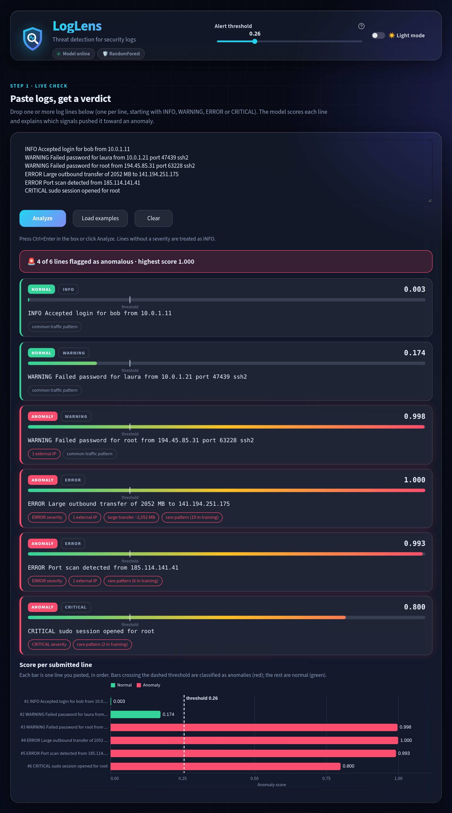
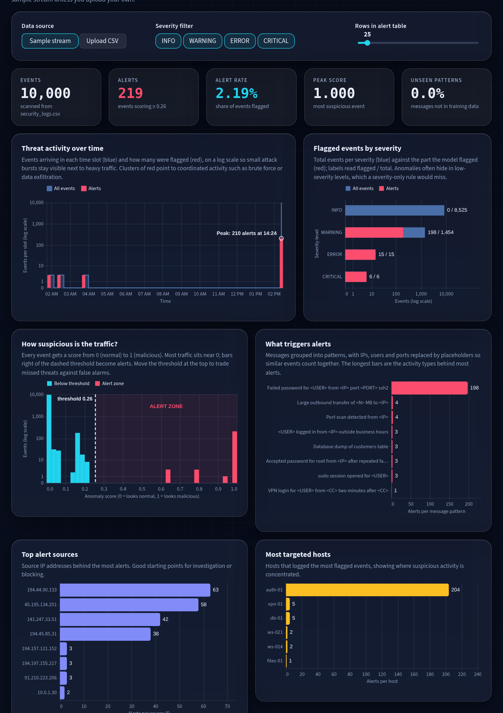

# Log Anomaly Detection Model

This project explores log anomaly detection and includes a saved message-based
classifier that can score individual log events. The analysis and model-training
workflow is in [`anomaly_detection.ipynb`](./anomaly_detection.ipynb); the
command-line scorer is [`src/loglens/detect_anomaly.py`](./src/loglens/detect_anomaly.py).

## Project contents

| Path | Description |
| --- | --- |
| `streamlit_app.py` | Thin launcher for Streamlit Community Cloud and `streamlit run streamlit_app.py`. |
| `src/loglens/ui/app.py` | The LogLens single-page Streamlit app. |
| `src/loglens/ui/assets/` | LogLens logo (`logo.svg`) and favicon (`favicon.png`). |
| `src/loglens/detect_anomaly.py` | Command-line scorer (`uv run detect-anomaly`), also used by the web app. |
| `src/loglens/cli.py` | Entry point behind `uv run app`. |
| `.streamlit/config.toml` | Base Streamlit theme. |
| `docs/screenshots/` | Screenshots used in this README. |
| `data/train.csv` | Small sample with `type`, `line`, and `anomaly_score`; its labels are not reliable training ground truth. |
| `data/test.csv` | 10,000 security-log events used for analysis and proxy evaluation. |
| `data/combined_train.csv` | Dataset used to train the saved message classifier. |
| `data/security_logs.csv` | Security-log events used as the scorer's default input. |
| `artifacts/message_detector.joblib` | Saved message-based Random Forest classifier and feature builder. |
| `artifacts/isolation_forest_detector.joblib` | Saved streaming Isolation Forest detector from the notebook. |
| `artifacts/model_results.json` | Model parameters, threshold, and evaluation summaries. |
| `artifacts/test_scored_results.csv` | Per-event scores and comparison results for the test stream. |
| `artifacts/alerts.csv` | Isolation Forest alerts from the test stream. |
| `artifacts/security_logs_scored.csv` | Example output from the command-line scorer. |
| `docs/model_behaviour_report.md` | Detailed results, limitations, and recommendations. |

## Setup

Dependencies are managed with [uv](https://docs.astral.sh/uv/). Install uv, then
create the environment (Python 3.11, pinned in `.python-version`) from the
project directory:

```bash
cd anamoly_detection_model_training
uv sync                    # scoring only
uv sync --group notebook   # also installs Jupyter kernel, matplotlib and seaborn for the notebook
```

`uv sync` creates `.venv/` and installs the locked versions from `uv.lock`.
Activate the virtual environment before running anything else in this project:

```bash
source .venv/bin/activate        # Windows: .\.venv\Scripts\activate
```

The commands below assume the environment is active. Without activating it,
prefix them with `uv run` instead.

The saved models are serialized Python/scikit-learn objects pickled with
scikit-learn 1.9.1, which is why `pyproject.toml` pins `scikit-learn~=1.9.1`.
Load only model files you trust.

## Run the web app

LogLens is a single-page Streamlit dashboard for log analysis. Start it from the
project directory:

```bash
uv run app
```

Extra arguments go to Streamlit, e.g. `uv run app --server.port 8600`. With the
virtual environment active, `streamlit run streamlit_app.py` does the same.

Then open <http://localhost:8501>. The page has a glass-style dark theme and a
light theme (toggle in the header), and everything is controlled in the page
itself:

1. **Live check (top):** paste one or more log lines (one per line, optionally
   starting with `INFO`, `WARNING`, `ERROR` or `CRITICAL`). Each line gets a
   verdict, an anomaly score against the threshold, the signals behind it
   (severity, external IPs, large transfers, rare patterns) and a score chart.
2. **Stream analysis (below):** scores `data/security_logs.csv` by default; pick
   "Upload CSV" for your own file with `severity` and `message` columns. It shows
   summary metrics, threat activity over time, flagged events by severity, the
   score distribution, top alerting message patterns, top source IPs, most
   targeted hosts and a table of the highest-scoring alerts (downloadable as CSV).
   Each chart has a short explanation and annotations (threshold, peak, labels).

The alert threshold slider in the header applies to both sections. The logo and
favicon live in `src/loglens/ui/assets/`.





### Host on Streamlit Community Cloud

Deploy the repository on [share.streamlit.io](https://share.streamlit.io) with
`streamlit_app.py` as the main file and Python 3.11. It only adds `src/` to the
path and runs `src/loglens/ui/app.py`. Dependencies come from `pyproject.toml`
and `uv.lock`; `data/` and `artifacts/` must be committed because the app loads
them. Keep `scikit-learn~=1.9.1` (the model was pickled with it), and only deploy
artifacts you trust.


## Score logs

From `anamoly_detection_model_training/`, score the bundled `data/security_logs.csv` file and write the results to
`artifacts/security_logs_scored.csv`:

```bash
uv run detect-anomaly
```

The CSV input must contain `severity` and `message` columns. To score another
CSV and choose an output path:

```bash
uv run detect-anomaly --csv path/to/logs.csv --out artifacts/scored.csv
```

The output preserves the input columns and adds:

- `anomaly_prob`: the model's estimated anomaly probability.
- `anomaly`: `1` when that probability meets the saved alert threshold, otherwise `0`.

The scorer also prints alert counts, the fraction of unseen message templates,
and the highest-scoring alerts. If the input contains `event_type`, `source_ip`,
and `bytes_out`, it additionally prints a comparison with rule-derived proxy
labels; these are diagnostic labels, not ground truth.

The CLI also accepts individual log lines. Include a severity prefix when
available; lines without one are treated as `INFO`:

```bash
uv run detect-anomaly "WARNING Failed password for bob from 203.0.113.7 port 22 ssh2"
uv run detect-anomaly --file path/to/logs.txt
uv run detect-anomaly --samples
```

Text files should contain one log line per line. The `--samples` option scores
example lines drawn from the bundled security logs.

## Run the analysis

After `uv sync --group notebook`, open [`anomaly_detection.ipynb`](./anomaly_detection.ipynb)
in VS Code or Jupyter using the `.venv` kernel, with this project directory as
the working directory, and execute its cells in order. The notebook explores the
provided datasets, compares supervised and unsupervised detectors, evaluates
proxy labels, and saves model and result artifacts under `artifacts/`.

## Interpreting the results

The evaluation labels are heuristics derived from fields such as `event_type`,
`source_ip`, and `bytes_out`; they are not independently verified incident
labels. Some of these fields are reflected in the message text, so high scores
can mean the model learned the proxy-label rules rather than generalizable
attack behavior. The data is also short and contains few distinct attacks.
Treat reported metrics and the saved threshold as exploratory, not as a
production accuracy guarantee. Review [`docs/model_behaviour_report.md`](./docs/model_behaviour_report.md)
for detailed findings and recommendations before using alerts operationally.